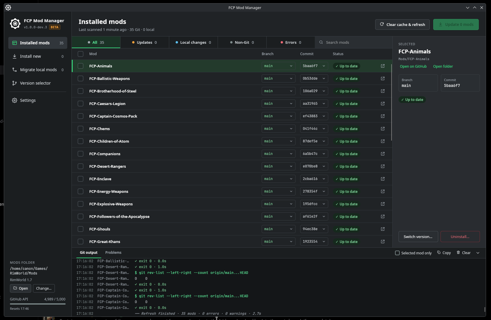

<h1 align="center">Collaboration Project Updater</h1>

<p align="center">
  
</p>

<p align="center">
  <strong>A desktop app and CLI for managing Fallout and Elder Scrolls Collaboration Project RimWorld mods.</strong>
</p>

<p align="center">
  List, install, update, and manage FCP and ESCP mods.
</p>

<p align="center">
  <a href="https://github.com/FalloutCollaborationProject/FCP-Mod-Updater/releases/latest">
    
  </a>
  <a href="https://github.com/FalloutCollaborationProject/FCP-Mod-Updater/releases">
    
  </a>
  <a href="https://discord.gg/XcgBf3AbPa">
    
  </a>
</p>

<p align="center">
  <a href="https://github.com/FalloutCollaborationProject/FCP-Mod-Updater/stargazers">
    
  </a>
  <a href="https://github.com/FalloutCollaborationProject/FCP-Mod-Updater/releases">
    
  </a>
  <!-- <a href="LICENSE">
    
  </a> -->
  <a href="https://github.com/FalloutCollaborationProject/FCP-Mod-Updater/actions/workflows/ci.yml">
    
  </a>
</p>

<p align="center">
  
</p>

## Features

- **Auto-discover** RimWorld installation across Steam, GOG, and Lutris on Windows, Linux, and macOS
- **Interactive mode** with rich terminal UI for browsing, updating, and managing mods
- **Batch update mode** for automation scripts
- **Install new mods** directly from the FCP and ESCP GitHub organizations
- **Convert local mods** (ZIP downloads) to Git repositories for easy updates
- **Branch/commit switching** for testing specific mod versions
- **Status overview** showing update availability, local changes, and sync state

## Requirements

- [Git](https://git-scm.com/downloads) installed and available in PATH

## Installation

### Standard Installation

> [!NOTE]
> Your anti-virus may flag the download as suspicious/malicious, this is due to the code being unsigned. To remedy this would cost us real money and not a small amount either, you may check on [VirusTotal](https://www.virustotal.com/gui/) or [build from source.](#build-from-source)

> [!TIP]
> **Not sure which file to download?** On Windows, run **`CollabProjectUpdater-win-x64-Setup.exe`**; on Linux, grab **`CollabProjectUpdater-x86_64.AppImage`**. Both are the desktop app, update themselves from inside the app, and need nothing installed apart from Git.

| Archive | What it is | Who it's for |
|---------|------------|--------------|
| `CollabProjectUpdater-win-x64-Setup.exe` | Desktop app installer for Windows (per-user, no admin; Start Menu and Desktop shortcuts) | **Most Windows users** |
| `CollabProjectUpdater-x86_64.AppImage` | Desktop app for Linux as one file: `chmod +x` it and run | **Most Linux users** |
| `CollabProjectUpdater-win-x64-Portable.zip` | Windows desktop app without installing; still updates itself | Windows users who want a portable folder |
| `CollabProjectUpdater-CLI-*-selfcontained.zip` / `.tar.gz` | Command-line app, everything bundled | Terminal users |
| `update-collab-project-updater.bat` / `.sh` | Updater script: updates the CLI, and switches an old plain desktop-app folder to the self-updating version | CLI users; old plain-folder installs |

Downloads are available on the [Releases](https://github.com/FalloutCollaborationProject/FCP-Mod-Updater/releases) page. What changed in each version is in [CHANGELOG.md](CHANGELOG.md).

### Updating the App

The desktop app checks for newer releases on launch. If you installed it with `Setup.exe`, the AppImage or the Velopack portable zip, click **Update now** in the banner: it downloads the update and restarts into the new version (pre-releases only when "include pre-releases" is on in Settings).

If you use an old plain GUI zip/tar.gz (no longer published) or the old AppImage, the banner offers **Get the installer** to switch once (your settings are kept). The CLI uses the updater scripts, which are separate downloads on each release (not inside the archives): put the one for your platform in the app folder.

| Platform | Script |
|----------|--------|
| Windows | `update-collab-project-updater.bat` |
| Linux | `./update-collab-project-updater.sh` |

Before running an updater script, close Collaboration Project Updater and run the script from the existing app folder. The script will ask whether to use the latest stable release or the latest pre-release, download the matching archive and `checksums.txt`, verify the SHA256 checksum, then replace the files in the current folder. Run in an old plain desktop-app folder, it installs the portable zip (Windows) or the AppImage (Linux) there instead and removes the old app files; from then on the app updates itself. Use the script from the latest release: older copies look for the plain archives, which are no longer published.

> [!NOTE]
> The app was renamed from FCP Mod Manager. Updater scripts from before the rename (`update-fcp-mod-manager.*`) can't find the new archives: download `update-collab-project-updater.sh`/`.bat` from the latest release into your old app folder once and run it. It installs the renamed app and removes the old files.

> [!WARNING]
> The updater scripts are mainly convenience helpers. If an update fails, download the release archive manually and replace the app folder yourself.

> [!WARNING]
> The Windows updater script is less tested than the Linux script. If it fails, use the manual download method from the Releases page.

> [!NOTE]
> The Linux updater requires `curl`, `tar`, and `sha256sum`. Choosing the pre-release channel also requires `python3` for GitHub release JSON parsing.


### Build from Source
```bash
git clone https://github.com/FalloutCollaborationProject/FCPModUpdater.git
cd FCPModUpdater
dotnet build
```

## Status Icons (CLI)

| Icon | Status | Description |
|------|--------|-------------|
| ✓ | Up to Date | No updates available |
| ↓ | Behind | Updates available |
| ↑ | Ahead | Local commits not on remote |
| ⇅ | Diverged | Both behind and ahead |
| ~ | Modified | Has uncommitted local changes |
| — | Not Git | Local folder (not a git repo) |
| ✗ | Error | Git operation failed |
